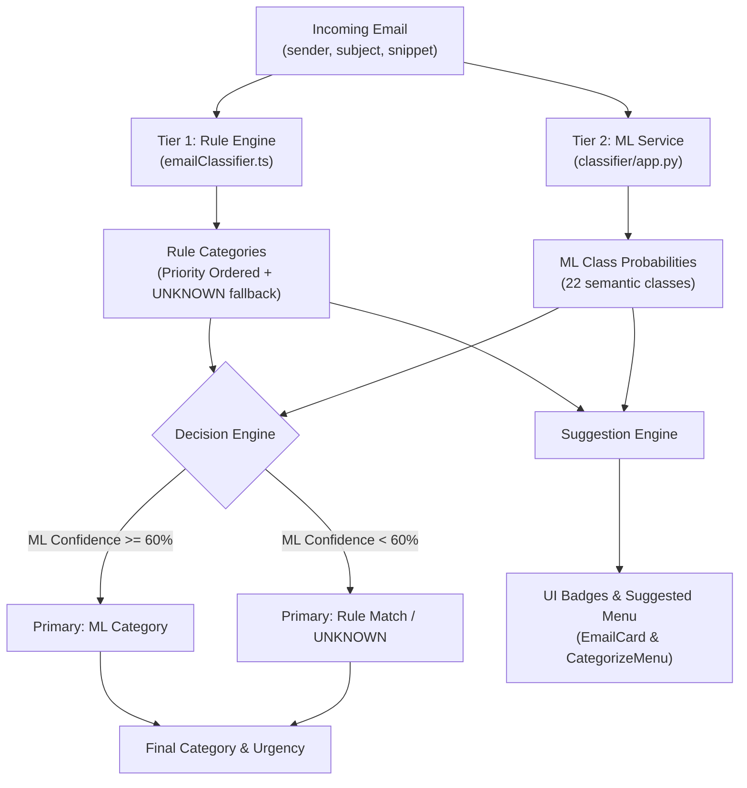

# Uncluttered Email Classification System

This document outlines the architecture, decision hierarchy, machine learning pipeline, confidence thresholds, and UI integration for the Uncluttered email classification system.

---

## 1. High-Level Architecture

The classification system uses a **two-tier hybrid model**:



1. **Sub-millisecond Rule Engine (`server/src/emailClassifier.ts`):** Evaluates regex patterns, domain lists, and sender overrides. Operates synchronously with zero external dependencies.
2. **Scikit-Learn ML Microservice (`classifier/app.py`):** Fast Logistic Regression + TF-IDF pipeline running on Python/FastAPI (`http://localhost:7002`). Calculates probability distributions across all 22 categories in $<1$ ms.
3. **Hybrid Decision Engine:** Combines the two predictions using confidence thresholds and fallback hierarchies.
4. **Suggestion Engine:** Surfaces high-probability alternatives or best-guess candidates when an email is `UNKNOWN` or close to the auto-categorization threshold.

---

## 2. Category Taxonomy & Role of `UNKNOWN`

The classifier recognizes **22 semantic categories**:
`ACCOUNTS`, `APPOINTMENT_REMINDER`, `BANKING_ACCOUNT`, `COMMUNITY_LOCAL`, `CREATOR_CONTENT`, `DEVELOPER_SERVICES`, `EVENT_TICKET`, `FINANCE_BILL`, `FOOD_ORDER`, `GAMING`, `HEALTHCARE_MEDICAL`, `NEWSLETTER`, `NONPROFIT_ADVOCACY`, `ORDER_SHIPPING`, `PERSONAL`, `POLITICAL`, `PROMO_MARKETING`, `RECRUITER`, `SOCIAL_MEDIA`, `SUBSCRIPTION_SERVICE`, `SYSTEM_ALERT`, `TRAVEL_BOOKING`.

> [!IMPORTANT]
> **Why `UNKNOWN` is not in the ML training set:**
> - `UNKNOWN` is **not a topic**; it is the **absence of certainty**.
> - In the database and UI, `UNKNOWN` is the essential fallback bucket that places unconfident or ambiguous emails into the user review queue (`/` route).
> - If `UNKNOWN` were trained as an ML class, it would absorb 70%–85% of probability mass for any generic email, squashing all real categories into tiny fractions (< 5%).
> - By training ML strictly on the 22 real categories, low-confidence emails naturally produce probabilities like 20%–45% among plausible categories, generating accurate suggestions.

---

## 3. Tier 1: Rule-Based Classifier

Located in `server/src/emailClassifier.ts`:

1. **Sender Parsing:** Splits sender into `displayName`, `localPart` (e.g. `no-reply`), and `domain`.
2. **Named Sender Overrides:** Checked first before domain lists (e.g., `notifications@github.com` $\rightarrow$ `DEVELOPER_SERVICES`, `Team Headway` + invoice $\rightarrow$ `HEALTHCARE_MEDICAL`).
3. **Priority Order Checks:**
   - Strict transactional categories checked early (`RECRUITER`, `APPOINTMENT_REMINDER`, `EVENT_TICKET`, `FOOD_ORDER`, `ORDER_SHIPPING`, `TRAVEL_BOOKING`, `BANKING_ACCOUNT`).
   - Guard rules protect against promotional hijacking (e.g., airline promo emails with sales/discounts are classified as `PROMO_MARKETING` instead of `TRAVEL_BOOKING`).
   - Broad categories (`COMMUNITY_LOCAL`, `PERSONAL`, `NEWSLETTER`, `SUBSCRIPTION_SERVICE`, `SOCIAL_MEDIA`, `PROMO_MARKETING`) checked later.
4. **Fallback:** If no pattern or domain matches, rules append `'UNKNOWN'`.

---

## 4. Tier 2: Machine Learning Classifier

Located in `classifier/app.py`:

### Feature Engineering (`build_text`)
Constructs a single structured text string for TF-IDF:
- **Sender tokens:** `from:<domain>`, `from:<root_domain>`, `sender_role:<clean_local_part>`, `name:<clean_display_name>`.
- **Intent cue tokens:** Regex-based intent triggers (`signal:promo`, `signal:booking`, `signal:receipt`).
- **Subject double-weighting:** `subject` is repeated twice to emphasize intent over email boilerplate:
  ```text
  sender_tokens + intent_tokens + subject + subject + snippet
  ```

### Model Pipeline
- **Vectorizer:** `TfidfVectorizer(min_df=2, max_features=15000, ngram_range=(1, 2), sublinear_tf=True)`
- **Classifier:** `LogisticRegression(max_iter=500, class_weight="balanced", C=2.0)`

### Output Schema
`POST /classify` returns:
```json
{
  "category": "ORDER_SHIPPING",
  "confidence": 0.4852,
  "ready": true,
  "categories": [
    { "category": "ORDER_SHIPPING", "confidence": 0.4852 },
    { "category": "FINANCE_BILL", "confidence": 0.2214 },
    { "category": "PROMO_MARKETING", "confidence": 0.0811 }
  ]
}
```

---

## 5. Decision & Suggestion Engine

Configured in `server/src/emailClassifier.ts`:

### Thresholds
| Parameter | Env Variable | Default | Purpose |
| :--- | :--- | :--- | :--- |
| **Auto-Classify Threshold** | `CLASSIFIER_MIN_CONFIDENCE` | `0.60` (60%) | Minimum ML confidence needed to assign category over rules. |
| **Alternative Suggestion Threshold** | `CLASSIFIER_SUGGESTION_MIN_CONFIDENCE` | `0.35` (35%) | Shows competitors close to the threshold when an email is already categorized. |
| **Unknown Suggestion Threshold** | `CLASSIFIER_UNKNOWN_SUGGESTION_MIN_CONFIDENCE` | `0.15` (15%) | Surfaces top suggestions when the email is `UNKNOWN` (baseline across 22 classes is ~4.5%). |

### Category Decision Logic
1. If ML is available and `confidence >= 0.60`: Primary category becomes ML's top choice.
2. If ML confidence $< 0.60$: Primary category defaults to Tier 1 rules (which is `UNKNOWN` if no rules match).

### Suggestion Selection Logic
```typescript
const baseCategory = currentCategory ?? primaryCategory;
const isUnknown = !baseCategory || baseCategory === 'UNKNOWN';
const excludeList = isUnknown ? ['UNKNOWN'] : [baseCategory, 'UNKNOWN'];

// Min confidence: 15% if UNKNOWN, 35% if already categorized
const minConfidence = isUnknown ? 0.15 : 0.35;

const mlSuggestions = candidates
  .filter(c => !excludeList.includes(c.category) && c.confidence >= minConfidence)
  .slice(0, 3);
```
- **When category is `UNKNOWN`:** Top non-UNKNOWN candidates with $\ge 15\%$ confidence are shown (e.g. `[ Travel Booking · 48% ] [ Promo Marketing · 22% ]`).
- **When category is known:** Candidates close to the threshold ($\ge 35\%$) are shown as alternative options.
- **Deduplication:** ML suggestions take precedence to show the confidence score; rule-based secondary matches fill any remaining slots.

---

## 6. Training & Retraining Lifecycle

1. **Datasets Combined:**
   - **Base data:** 22 JSON files in `classifier/training/*.json` (100 synthetic examples per category).
   - **Live data:** User email history from `server/data/db.json` (excluding `UNKNOWN`).
2. **Sample Weighting:**
   - **Gold data (`weight = 6.0`):** Emails validated or manually overridden by the user.
   - **Silver data (`weight = 1.5`):** Unvalidated AI-classified emails.
   - **Base data (`weight = 1.0`):** Synthetic bootstrapped examples.
3. **Retraining Triggers:**
   - **On manual categorizations:** Increments counter; triggers retrain every 20 user actions (`AUTO_RETRAIN_THRESHOLD`).
   - **Nightly Cron:** Daily retrain scheduled at `04:00` (daily backup at `03:55`).
   - **Docker safeguard:** Startup retrain is skipped inside Docker containers to avoid high CPU spikes on NAS hardware.

---

## 7. UI Integration

- **`useSuggestions` Hook (`react/src/hooks/useSuggestions.ts`):** Fetches real-time suggestions for the currently active email in the stack, passing `currentCategory`.
- **`EmailCard` (`react/src/components/EmailCard.tsx`):** Renders clickable suggestions directly below the email snippet with event propagation stopped. Clicking a suggestion immediately updates the email.
- **`CategorizeMenu` (`react/src/components/CategorizeMenu.tsx`):** Dynamically displays a **Suggested** section at the top of the sidebar/sheet with amber border styling and percentage badges.
- **Review Filter (`react/src/hooks/useEmails.ts`):** The review page displays any email where `validated !== true` OR category is `UNKNOWN`, enabling a two-pass review workflow.
